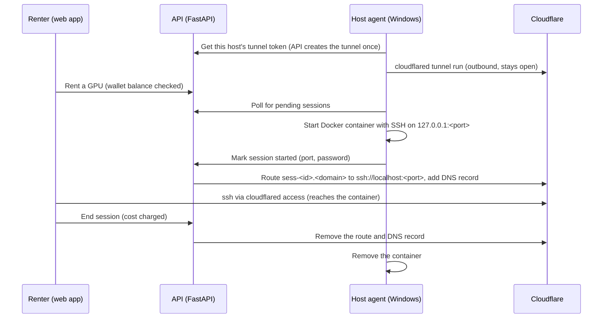

# Labhya Compute

A marketplace where people can rent out idle GPUs by the hour. Hosts run a small desktop app that starts a Docker container on their machine; renters connect to that container over SSH through Cloudflare Tunnel, so neither side needs a public IP or port forwarding.

Labhya Compute started as our 7th-semester college project at Tribhuvan University, built by a team of three: **Sudip Niroula, Sugam Dahal and Saurab Prasai** (August 2025). It won Most Innovative Project at Ambition Hackathon 2025. The first version used Django REST Framework; in July 2026 Sudip rewrote the backend in FastAPI and SQLModel, and the Django code was removed.

## How it works



The host never deals with Cloudflare: the Cloudflare account and domain belong to Labhya, the API creates one tunnel per host through Cloudflare's API, and the agent ships with `cloudflared.exe` and runs it in the background. Renters install `cloudflared` once on their own computer.

| Part | Stack | Where |
|---|---|---|
| Web app | Next.js 15 (static export, served by the API), TypeScript, Tailwind CSS, shadcn/ui | `frontend/` |
| API | FastAPI, SQLModel, PostgreSQL, JWT auth | `backend/app/` |
| Host agent | Python, Tkinter, Docker, cloudflared; packaged as a Windows `.exe` with PyInstaller | `backend/agent/`, `build_agent.py` |
| Session image | Ubuntu 22.04 with OpenSSH | `backend/agent/docker/session/` |

A GitHub Actions workflow (`.github/workflows/build-agent.yml`) builds the Windows agent on every push to `main` and commits it to `frontend/public/downloads/`, where the web app offers it for download. The build bundles a pinned, checksum-verified `cloudflared.exe` and the API address from the `LABHYA_API_URL` repository variable, which must be set (Settings → Secrets and variables → Actions → Variables).

## Running it locally

**With Docker Compose** (PostgreSQL, API and web app):

```bash
docker compose up --build
```

The web app is then at http://localhost:3001 and the API at http://localhost:8080 (interactive docs at `/docs`).

**Without Docker** (needs [uv](https://docs.astral.sh/uv/)):

```bash
# API
cd backend
cp .env.example .env          # SQLite by default; fill in SECRET_KEY
uv sync                       # installs the exact versions in uv.lock
uv run fastapi dev            # http://localhost:8000, docs at /docs; creates or updates the tables on start
uv run python seed_dev.py     # optional: a test host with two GPUs and a test renter with funds

# Web app (in another terminal)
cd frontend
pnpm install
pnpm dev                      # http://localhost:3000, talks to the API on :8000 (.env.development)
```

The seed logins are at the top of `seed_dev.py`. Renting needs the four `CLOUDFLARE_*`/`TUNNEL_DOMAIN` settings (see Configuration); without them the API answers "Renting is turned off".

**Host agent:** needs Windows 10 or 11 with WSL2 and Docker. Either download the agent from the web app or run `python backend/agent/agent_gui.py`. Set `LABHYA_API_URL` to use an API other than `http://localhost:8000/api`.

**Tests:**

```bash
cd backend
uv run pytest
```

The tests build a temporary SQLite database with the real migrations. They cover the rental flow and billing, access rules, token refresh and revocation, login lockout and input validation, and they check that the models and migrations match. Set `TEST_DATABASE_URL` to an empty PostgreSQL database to run them against Postgres; CI (`.github/workflows/backend.yml`) does this on every push.

## Database migrations

Alembic manages the schema (`backend/migrations/`).

- **Apply migrations:** the API runs `alembic upgrade head` every time it starts, holding a PostgreSQL advisory lock so replicas starting together migrate once. You can also run `uv run alembic upgrade head` by hand.
- **After changing `app/models.py`:** run `uv run alembic revision --autogenerate -m "what changed"`, read the generated file in `migrations/versions/`, and commit it with the model change. `pytest` fails if a model changes without a migration.
- **Order on deploy:** because new code migrates when it starts while old replicas may still be serving, migrations must not break the running version. Adding columns or tables is safe in one deploy. To drop or rename a column, first deploy code that stops using it, then deploy the migration that drops it. Don't add and drop in the same migration.

## Deploying the API to FastAPI Cloud

The API is set up for [FastAPI Cloud](https://fastapicloud.com):
- `pyproject.toml` names the app (`[tool.fastapi] entrypoint`).
- `uv.lock` pins every dependency.
- `.python-version` pins Python 3.11.
- `.fastapicloudignore` keeps the agent, tests and local files out of the upload.

1. **Log in and create the app** (from `backend/`): `uv run fastapi login`, then `uv run fastapi cloud apps create --name labhya-compute --link`.
2. **Attach a PostgreSQL database.** `uv run fastapi cloud integrations resources connect` opens the dashboard; connect a Neon or Supabase database. It sets `DATABASE_URL` for the app as a secret.
3. **Set the configuration:**
   ```bash
   uv run fastapi cloud env set ENVIRONMENT production --no-redeploy
   python -c "import secrets; print(secrets.token_urlsafe(48), end='')" | uv run fastapi cloud env set SECRET_KEY --value-stdin --secret --no-redeploy
   uv run fastapi cloud env set CORS_ALLOWED_ORIGINS https://your-web-app.example --no-redeploy
   uv run fastapi cloud env set SIMULATED_PAYMENTS false --no-redeploy
   ```
   `SIMULATED_PAYMENTS` is explained under "No real payments" below.
4. **Set up Cloudflare** (once, for the whole platform; hosts never see it):
   - Add a domain to a Cloudflare account.
   - Create an API token (My Profile → API Tokens → Custom token) with **Account → Cloudflare Tunnel → Edit** and **Zone → DNS → Edit** for that domain only.
   - Set them on the app:
     ```bash
     uv run fastapi cloud env set CLOUDFLARE_API_TOKEN --secret --no-redeploy   # prompts for the value
     uv run fastapi cloud env set CLOUDFLARE_ACCOUNT_ID <account id> --no-redeploy
     uv run fastapi cloud env set CLOUDFLARE_ZONE_ID <zone id> --no-redeploy
     uv run fastapi cloud env set TUNNEL_DOMAIN yourdomain.com --no-redeploy
     ```
     The account and zone IDs are on the domain's Overview page in Cloudflare, under "API".
5. **Build the web app into the API:** in `frontend/`, run `pnpm build:api`. It exports the site as static files to `backend/static/`, which the API serves at `/` (API routes under `/api` take priority). The agent downloads in `frontend/public/downloads/` go with it.
6. **Deploy:** in `backend/`, run `uv run fastapi deploy`. The API applies migrations when it starts. Open `https://<your-app>/health`; it returns `{"status": "ok"}` when the API can reach the database.

The site and API share one address, so the browser needs no CORS setup. Set the `LABHYA_API_URL` repository variable to `https://<your-app>/api` so the agent build points at the API.

Live: https://labhya-compute.fastapicloud.dev

With `ENVIRONMENT=production`, the API refuses to start unless:
- `SECRET_KEY` has at least 32 characters,
- `DATABASE_URL` points to PostgreSQL,
- `CORS_ALLOWED_ORIGINS` lists exact origins.

In production it also turns off `/docs` and sends the HSTS header.

The `Dockerfile` builds the same app for any container host and runs it as a non-root user.

## Configuration

| Variable | Used by | Purpose |
|---|---|---|
| `ENVIRONMENT` | API | `development` (default) or `production`, which turns on the checks above |
| `DATABASE_URL` | API | PostgreSQL connection string (`postgres://` and `postgresql://` both work). Defaults to a local SQLite file for development |
| `SECRET_KEY` | API | Signs login tokens. Required in production. Changing it logs everyone out |
| `CORS_ALLOWED_ORIGINS` | API | Comma-separated web app origins, e.g. `https://app.example.com` |
| `CLOUDFLARE_API_TOKEN`, `CLOUDFLARE_ACCOUNT_ID`, `CLOUDFLARE_ZONE_ID`, `TUNNEL_DOMAIN` | API | Cloudflare Tunnel, which connects renters to containers. Sessions get `sess-<id>.<TUNNEL_DOMAIN>`. Without all four, renting and hosting are turned off |
| `ACCESS_TOKEN_EXPIRE_MINUTES`, `REFRESH_TOKEN_EXPIRE_DAYS` | API | Token lifetimes (default 30 minutes and 14 days) |
| `MAX_FAILED_LOGINS`, `LOGIN_LOCKOUT_MINUTES` | API | Lock an account after this many wrong passwords in a row (default 5), for this long (default 15 minutes) |
| `SIMULATED_PAYMENTS` | API | `true` lets renters add funds and hosts withdraw with no real payment (default `true`) |
| `NEXT_PUBLIC_API_URL` | Web app (build time) | Base URL of the API. Defaults to `/api` (same origin); `.env.development` points `pnpm dev` at `http://localhost:8000/api` |
| `LABHYA_API_URL` | Agent build, host agent | Base URL of the API, ending in `/api`. Baked into the agent at build time; setting it on a host's PC overrides that |

## Security

- **Passwords:** hashed with bcrypt. A wrong email and a wrong password take the same time to reject. After 5 wrong passwords in a row, the account is locked for 15 minutes.
- **Tokens:** access tokens last 30 minutes and refresh tokens 14 days. Logging out revokes every token the account holds, on all devices.
- **Input:** every request body is checked against a strict schema. Unknown fields are rejected, and lengths and ranges are limited.
- **Other people's data:** sessions and GPUs that belong to someone else return 404, so their IDs can't be probed.
- **Money:** each money movement happens in one database transaction with the wallet rows locked. A session can't be charged twice, and two renters can't rent the same GPU at once. Sessions are billed at the price the GPU had when it was rented.
- **Headers and errors:** responses send `nosniff`, `X-Frame-Options: DENY`, `no-referrer` and `no-store`, and production adds HSTS. CORS allows only the configured origins. Unexpected errors are logged and return a generic message.

## Known limitations

- **No real payments.** With `SIMULATED_PAYMENTS=true`, adding funds credits the wallet without taking money from anywhere, and withdrawals pay nothing out. In production, set it to `false` until a payment provider is connected; renters then can't add funds.
- **Running out of money is only checked while the host's agent is online.** Each time the agent polls, the API ends any session whose cost has reached the renter's balance. If the agent goes offline mid-session, the session keeps billing until the renter or host ends it. A balance can drop below zero by a few seconds' cost, and new rentals are blocked while it is negative.
- **Windows-only hosts.** The agent depends on WSL2 and Docker Desktop.
- **SSH passwords are stored in plain text** in the database so the renter can see them. Anyone who learns a session's hostname can reach that container's SSH login, which is protected only by the per-session password until the session ends. Per-session SSH keys, or a Cloudflare Access policy, would close this.
- **Renters need `cloudflared`.** SSH goes through Cloudflare, so renters install `cloudflared` once. A browser terminal would remove that step.
- **No rate limiting by IP.** Logins are limited per account only. If the API gets abused, add IP-based limits at the edge (a CDN or reverse proxy).
- **Databases created before Alembic can't be migrated.** The first migration builds the schema from scratch. A database created by the old `create_all` code has a different schema, so it has to be recreated.
- **The Windows agent GUI hasn't run a real session yet.** The full path was tested on the live API with real Cloudflare: tunnel created, session routed, SSH login into the session container through `cloudflared`, billing, and the address going dead when the session ended. That test drove the steps from a script; the agent's own session handling is tested separately with Cloudflare, Docker and cloudflared faked.
- **A brand-new session address can take a few seconds to resolve.** If a renter's computer looks the name up in that window, it may cache "not found" for a while. Waiting a moment before connecting avoids it.
- **Built agent binaries live in the repository.** Publishing them as GitHub Release assets would keep the repository small.

## Repository layout

```
backend/
  app/            FastAPI app: models, schemas, billing, routers (auth, gpus, sessions, wallets, dashboard)
  migrations/     Alembic migrations
  agent/          Host agent (Tkinter GUI) and the session container image
  tests/          API tests
frontend/         Next.js web app
build_agent.py    Packages the agent with PyInstaller
docker-compose.yml
```
